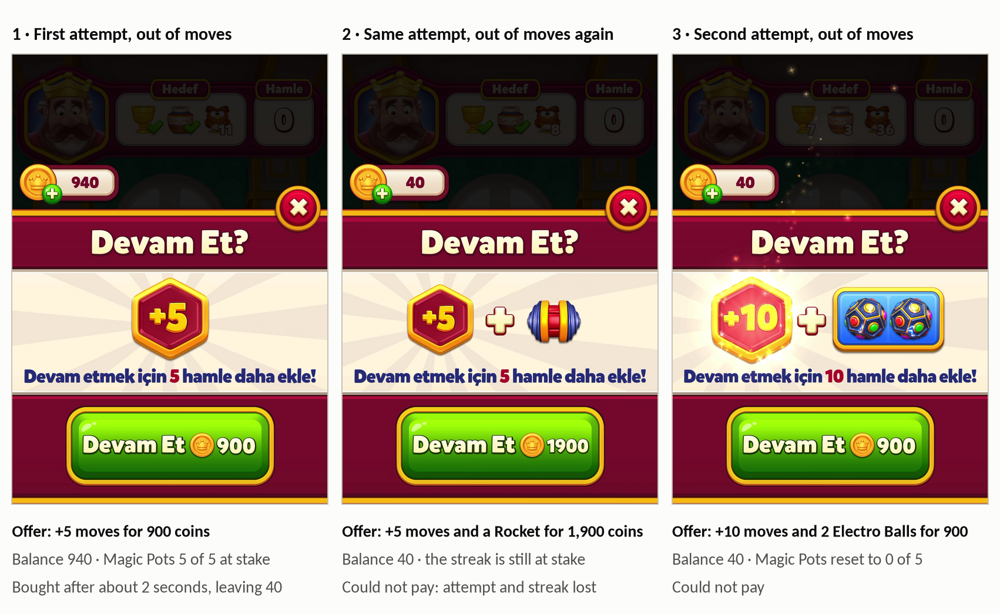

# Out of moves in Royal Kingdom

One new player's first 100 levels, and what the continue offer did while a win streak was at stake.

This is an independent player study. I am not affiliated with Dream Games. I played Royal Kingdom from level 1 to level 100 on a new account (iOS, Türkiye store, 4 to 11 November 2026), spent no money, recorded the screen from level 15 on, and turned the recordings into tables.



**What I saw.** In my log the first continue offer of an attempt, always 900 coins, was at its smallest while the win streak could still be saved, and it grew only on retries, after the streak had reset. The two-page memo says how firm that is, what I did as a player, and which single experiment I would run: [memo/out_of_moves.pdf](memo/out_of_moves.pdf) ([markdown](memo/out_of_moves.md)).

This is one player's log. It shows what happened to me, not what happens on average.

## Proposed measurement design (not run)

This is how I would log the proposed test, not something I ran or saw inside the game. Three records are enough for the memo's primary metric, the split between arms and a check that each player was shown the offer of their arm. Every row carries the player ID, the ID of the player's first eligible encounter and a timestamp: the two IDs join the records, and the timestamps show that assignment came before the offer and put later offers in order.

| Record | One row per | What it holds | What it checks |
|---|---|---|---|
| **Assignment** | Eligible player, written once, before the first eligible offer is shown | Arm; level ID; level configuration ID; client version; session ID; coin balance and Magic Pots stage just before assignment | The split between arms; that eligibility and the arm were fixed before the offer was shown |
| **Offer shown** | Continue offer shown to an assigned player | Order in the attempt; price; moves and extras; whether the Kingdom Pass card was shown and what it offered; the decision | That the first eligible offer matched the player's arm and later offers stayed as in control. On the 53 offers in my log where the Kingdom Pass card was readable in the first four sampled frames, it offered the same number of extra moves as the coin offer, so this record also shows whether +10 changed the card |
| **Level outcome** | Assigned player, for the level of the first eligible encounter | Passed in the same session or not; attempts used; coins spent in that session; streak saved | The primary metric: each assigned player counted once, at the first eligible encounter, buyers and non-buyers alike. Also assigned players with no matching offer row, and offer rows with no assignment |

The watch metrics come from records outside these three, joined on the player ID and read over a fixed window that starts when the first eligible offer is shown (I would use seven days): coins spent, from the coin transaction log; later continue-offer purchases, from the offer and purchase log; real-money pack revenue, from store purchases; day-7 return, from the session log; and payer status, from purchases made before the assignment timestamp. The memo's test table has the decision rule and reads the watch metrics by level and by payer status.

Choosing who gets more moves is a follow-up, not part of this test: both arms show +10 to the same share of eligible players, at random in one and by board and streak state in the other. King's live tests of model-chosen offers in Candy Crush Saga are the method reference ([arXiv:2408.06799](https://arxiv.org/abs/2408.06799)).

## What is here

| Path | Contents |
|---|---|
| `memo/out_of_moves.md`, `.pdf` | The memo |
| `data/levels.csv`, `attempts.csv`, `offers.csv` | One row per level (100), attempt (179) and logged continue offer (82) |
| `data/coin_income.csv` | The 21 non-level coin rewards (chests, events, a team reward and a help reward), each with its balance step |
| `data/side_checks.csv` | Six offers seen outside the 100 levels (a second account and the English client), not part of any count |
| `data/recordings.json` | Length of each of the 23 recordings |
| `DATA_DICTIONARY.md` | Every column, and how each kind of value was obtained |
| `analysis/make_report.py` | Reproduces the reported tables and draws the two charts |
| `analysis/check_memo_numbers.py` | 37 data checks: computes values from the tables and compares each with a fixed expected value. It does not read the memo or the PDF |
| `analysis/make_scorecard.py`, `scorecard.md` | A fixed set of metrics, so a second game can be measured the same way |
| `analysis/sample_size.py` | Players per arm for the proposed test |
| `analysis/video_ocr.swift`, `parse_ocr.py` | How the recordings were read: one frame per second, on-device OCR, then a parser |
| `results/report.md` | Output of `make_report.py` |
| `figures/` | The memo's figure and the two charts `make_report.py` draws |
| `PROTOCOL.md` | The method written up for a second game |
| `PREDICTIONS.md` | Seven predictions written after level 14, before level 15, and how each turned out |
| `RELATED.md` | Sources I used |

## Reproduce the numbers

Python 3.8 or later. These three commands need only the standard library:

```bash
python3 -I analysis/check_memo_numbers.py
```

```bash
python3 -I analysis/make_report.py --no-figures > results/report.md
```

```bash
python3 -I analysis/make_scorecard.py
```

The first should end with `37 data checks passed`. It computes values from the tables and compares each with a fixed expected value written into the script. It does not read the memo or the PDF, so it shows that the data still give the reported numbers, not that the memo quotes them correctly. The second stops with an error if a first-try count differs from the game's own counter, if the coins do not reconcile level by level, or if a recorded first offer breaks the offer formula.

The two charts need matplotlib. This writes the same report and redraws `figures/`:

```bash
python3 -I analysis/make_report.py > results/report.md
```

`python3 -I memo/build_pdf.py memo/out_of_moves.md --max-pages 2` rebuilds the PDF; it uses Google Chrome's macOS path.

## How the data was made

1. Screen recordings of every level from 15 to 100: 23 recordings, 362 minutes.
2. `video_ocr.swift` takes one frame per second and runs Apple's on-device text recognition on it.
3. A sanitising step removes other players' names, team chat and system notifications before anything else reads the text.
4. `parse_ocr.py` finds attempts, offers, wins and balances. I then checked every number used here by eye on the frame and entered the offer table by hand; the parser is the cross-check.
5. Levels 1 to 14 come from a form I filled in after each level, before I started recording.

The OCR tool is Swift and the analysis scripts are Python, written with Claude Code. The analysis scripts reproduce the reported study counts and tables from the study data.

Two checks tie the log to the game. First-try wins in the log equal the game's own counter at four points (8, 15, 38 and 68 after levels 10, 24, 50 and 100). The coins reconcile level by level, with every non-level coin reward itemized.

## What is not here, and why

- The recordings and the OCR text. They show other players' names and my notifications.
- My level notes. They are personal and in Turkish. The tables carry the structured fields.
- Recording file names and times of day. Recordings are called R01 to R23 and dates are kept to the day.
- The figure on this page is cropped from a recording, so it cannot be rebuilt from this repository.

## Limits

One player and one pass: I am an experienced match-3 player and knew I was studying the game. 100 levels in eight days. Türkiye store, Turkish client, no money spent. Magic Pots stages are derived from the game's published rule and checked on sample frames. My reasons for buying or declining were given afterwards. I make no claim about how the game sets difficulty or offers for any player.

## Notes

Royal Kingdom and its artwork belong to Dream Games. The screenshots are used to comment on what a player sees.

Doruk Özcan · [linkedin.com/in/doruk-ozcan](https://www.linkedin.com/in/doruk-ozcan)
