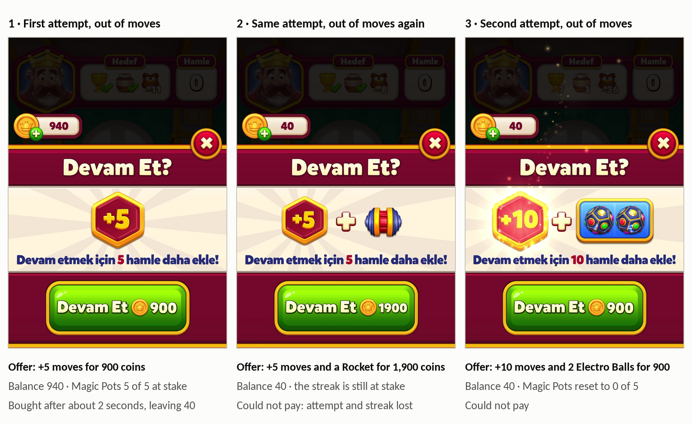

# Out of moves in Royal Kingdom

**One new player's first 100 levels, and what the continue offer did while a win streak was at stake**

Doruk Özcan · November 2026 · an independent player study, not affiliated with Dream Games

*Level 57, 9 November 2026, Turkish client, cropped. On the English client the same screens read "Out of Moves!", "Continue?" and "Play On".*

On level 57 I ran out of moves holding a full Magic Pots streak, a Dungeon Escape run and 940 coins. The game offered +5 moves for 900 coins. I bought it after about two seconds, which left me 40 coins, and ran out again. The second offer in the same attempt was +5 moves and a Rocket for 1,900 coins. I could not pay, and the attempt and the streak were lost. On the next attempt, with Magic Pots reset to zero, the offer was +10 moves and two Electro Balls for 900.

**In my log the first continue offer of an attempt, always 900 coins, was at its smallest while the streak could still be saved, and it grew only on retries, after the streak had reset.** The 1,900-coin offer is a separate thing: a second continue inside the same attempt, which I saw once. This is one player's log: what happened to me, not what happens on average.

## What I measured

I played levels 1 to 100 on a new account in the Türkiye store from 4 to 11 November 2026 and spent no money. Levels 1-14 come from a form I filled in after each level. Levels 15-100 come from 23 screen recordings (362 minutes), read at one frame per second with on-device OCR and checked by eye. The result is a table of 179 attempts and 82 logged continue offers: 78 on video, 4 from the form. Six failed attempts have no offer row: four from the form period and two made off camera. The analysis scripts, in Python and written with Claude Code, reproduce the reported study counts and tables from the study data.

Two checks tie the log to the game. First-try wins in my log equal the game's own counter at four points: 8, 15, 38 and 68 after levels 10, 24, 50 and 100. And the coins reconcile level by level: 878 at level 15, plus 3,117 in level rewards, plus 3,305 in 21 non-level coin rewards, each matched to a balance step on video, minus 6,300 spent on continues, gives the 1,000 on screen after level 100.

## What the offer did

- **It followed the attempt count.** The first offer of an attempt was +5 moves for each attempt on that level, up to +35, always for 900 coins, with two Electro Balls from the second step. The cleanest evidence is 35 consecutive pairs of first offers on the same level in the same recording: the second was five moves larger 33 times and stayed at the +35 cap twice. All 77 recorded first offers fit the formula; one is not a test, because on level 68 I used the formula to count two attempts made off camera. On level 9 my form shows +5 twice in a row, and a second account's video shows +5 for 900 on three attempts in a row. The first larger offer is on level 13 in my form and on level 19 on video; exactly where the ladder starts is open.
- **Its content and price did not follow my situation.** After Magic Pots unlocked I saw the first offer on a level 23 times, with 1 to 5 stages at stake: +5 for 900 every time, however close I was and however many coins I had. The exit did react: closing an offer with a streak or event at stake first showed what I was about to lose (23 of 23 such declines, 0 of 48 others), and when I tapped the button with too few coins (levels 57 and 86) it opened the shop.
- **So the bigger 900-coin offers came too late to save a streak.** The streak resets when an attempt is lost, and the first offer grows on the next attempt. All 42 first offers of +10 or more that I saw after Magic Pots unlocked therefore came with the pots empty. That follows from the two rules; my log only illustrates it, and I cannot tell from outside whether it is intended.

The streak mattered to me: the pots had been full for 21 levels in a row. I failed once in the 30 levels before level 57 and 61 times in the 44 levels from 57 on; harder levels and missing power-ups are mixed together in those numbers.

## What I did

- **Could I pay?** With the balance below the price I bought 0 of 59 offers and spent no real money, including on level 86, where I was 9 coins short with a streak and a Dungeon Escape run at stake. When it covered the price I bought 7 of 19.
- **Streak at stake, coins in hand.** I ran out on my first attempt six times with 3+ stages at stake and at least 900 coins. I bought +5 four times and won three of those attempts. On level 76 I declined, 31 items short.
- **Waiting.** On level 89 I had coins for exactly one continue. I declined +5, +10, +15 and +20, then bought +25 on the fifth attempt, five items short, and finished with 22 moves to spare. Asked afterwards, I said I had waited for an offer I was sure would finish the level. The streak had gone with the first decline.

## One experiment I would propose

**Question.** While the streak can still be saved, does a more generous first offer improve what happens to the player, and what does it cost the coin economy? Today's rule has a plausible logic: a player protecting a streak may need only a small push, and one who has just lost it may need more help.

| | |
|---|---|
| Who | First attempt on a level out of moves, Magic Pots at stage 3 or higher, at least 900 coins, and +5 for 900 under today's rules; decided before the offer is shown. Stage 3 is a pilot assumption your data should set. |
| Assignment | By player, fixed before the first eligible offer and kept for the whole test. |
| Arms | Control: +5 moves for 900 coins. Variant: +10 moves for 900 coins. The Kingdom Pass card, the rest of the screen and every later offer stay as in control. |
| Primary metric | Share of assigned players who pass the level of their first eligible offer in the same session, counted over everyone assigned, not only buyers. |
| Secondary | First-offer purchase rate; streak saved in that attempt. |
| Watch | Later offer purchases, coins spent per player, real-money pack revenue and day-7 return over a fixed window; read by level and by payer status. Neither of my accounts ever paid. |
| Decision | Set before launch: ship only if the pass-rate gain reaches the agreed minimum, its interval excludes zero and the watch metrics stay within their limits; otherwise call it a loss or inconclusive. |
| Sample | Set by the control arm's pass rate, which only you have. At 60%, detecting +2 points at alpha 0.05 and power 0.80 takes about 9,300 players per arm. |

If purchases rise but progress does not, I would check whether more streaks were saved or the same purchases only came earlier. If progress improves, a follow-up can separate choosing from giving more: both arms show +10 to the same share of eligible players, at random in one and by board and streak state in the other, and everyone else sees +5. King's live tests of model-chosen against random and expert-rule bundles in Candy Crush Saga are the model for it ([arXiv:2408.06799](https://arxiv.org/abs/2408.06799)). Offers the balance cannot cover are a separate question.

## Limits

One player and one pass: I am an experienced match-3 player and knew I was studying the game; 100 levels in eight days; Türkiye store, Turkish client, no money spent. Magic Pots stages are derived from the rule and checked on sample frames. My reasons were given after the fact. My fail counts describe the levels as my account was served them, and I make no claim about how the game sets difficulty or offers for any player.

The repository holds the study data, the scripts that reproduce the reported counts and tables, and data checks against fixed expected values; the checks do not read this memo.

Doruk Özcan · [linkedin.com/in/doruk-ozcan](https://www.linkedin.com/in/doruk-ozcan) · [github.com/dorukozcan](https://github.com/dorukozcan)
